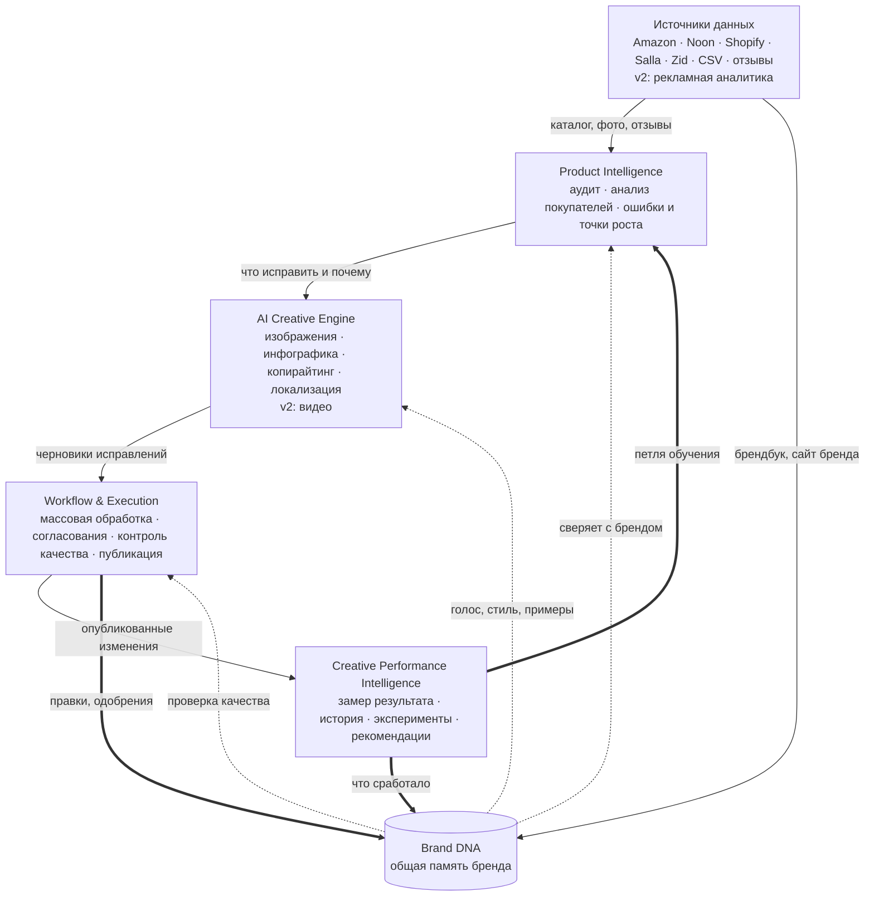

# Basira: план и статус

Обновлено: 2026-11-04 (Brand DNA MVP). Этот файл отвечает на вопросы «на каком мы этапе», «чего не хватает» и «что дальше». Статусы обновляются вместе с кодом: когда функция появляется, меняется строка здесь.

Статусы: **готово** · **частично** · **нет** · **v2** (сознательно отложено во вторую версию).

## Стратегия

**Стратегия Б: AI Product Content Intelligence для e-commerce-агентств.** Система обнаруживает недочёты товарного контента, использует обратную связь покупателей, создаёт брендовые исправления и помогает обновлять карточки в Amazon, Noon, Shopify и Salla.

Позиционирование на лендинге (`src/landing.html`, первый экран):

> **Improve hundreds of listings without growing your content team.**
> Find what's costing your clients sales, fix it in Arabic and English on brand, and publish faster across Amazon, Noon, Salla and Shopify.

## Пайплайн (целевая архитектура)

Подробная схема: [`docs/pipeline.html`](docs/pipeline.html) (опубликована как артефакт «Пайплайн Basira»).

Два принципа схемы:
1. **Петля обучения.** Результаты публикаций и правки команды возвращаются в Brand DNA и в аудит, поэтому со временем правок становится меньше. Это главный аргумент против генераторов без памяти.
2. **Brand DNA не шаг конвейера, а общая память.** Её читают аудит (соответствие бренду), Creative Engine (голос и стиль) и контроль качества; пополняют Workflow (правки и одобрения) и Performance (что сработало).

## Статус по слоям

### Источники данных

| Элемент | Статус | Где / заметки |
| --- | --- | --- |
| Amazon (.sa, .ae, .eg): карточка по ссылке, свой магазин | частично | `server/connectors/amazon.mjs`. Покрыто тестами на поддельной сети, вживую не проверено: нужны ключи SP-API |
| Noon: карточка по ссылке | частично | `server/connectors/page.mjs` (schema.org + страница `-ar`). Вживую не проверено |
| Noon: весь каталог | частично | Только через CSV-выгрузку из Seller Lab. Публичного API у Noon нет |
| Shopify: магазин и карточка | частично | `server/connectors/shopify.mjs`. Вживую не проверено |
| Salla, Zid: карточка по ссылке; каталог через CSV | частично | `page.mjs`, `catalog-csv.mjs`. Партнёрские API Salla и Zid не подключены |
| CSV-выгрузки | готово | `server/catalog-csv.mjs`, работает и в браузере |
| Брендбук и сайт бренда как источник | нет | Нужен для Brand DNA |
| Отзывы | частично | Вставляются вручную. Автосбора с площадок нет |
| Продажи и конверсия (для Performance v1) | нет | Amazon: SP-API Sales and Traffic report. Noon: выгрузки отчётов |
| Рекламная аналитика | v2 | Amazon Ads API, выгрузки Noon Ads |

### Product Intelligence

| Элемент | Статус | Где / заметки |
| --- | --- | --- |
| Аудит карточки (заголовки, арабский, фото, атрибуты, заявления SFDA) | готово | `server/audit.mjs` |
| Замер главного фото (размер, белый фон, заполнение кадра) | готово | `server/photo-metrics.mjs`, `render.mjs → probeImage` |
| Анализ отзывов на диалектах (Claude) | частично | `server/reviews.mjs`. Вживую не запускался: нет ключа API в среде разработки |
| Покрытие поисковых запросов | частично | `server/keywords.mjs`. Стартовые списки, без частотности |
| Юнит-экономика по каналам | частично | `server/economics.mjs`. Комиссии по умолчанию ориентировочные |
| Проверка фото и выбор лучшего (Claude) | частично | `server/photo.mjs`. Вживую не запускался |
| Сравнение с конкурентом | нет | Импорт и аудит уже есть, нужен экран «рядом» |
| Проверка соответствия бренду (Brand Consistency Score) | нет | Зависит от Brand DNA, см. `docs/brand-dna.md` |

### Brand DNA (общая память бренда)

Спецификация и архитектура (геном бренда с доказательствами): [`docs/brand-dna.md`](docs/brand-dna.md). Код: `server/brand-dna.mjs`, `server/brand-ai.mjs`, `server/store.mjs`, `server/brand-seed.mjs`; экран «Brand DNA» в `src/app.html`.

| Элемент | Статус | Где / заметки |
| --- | --- | --- |
| Структурированный профиль: айдентика (лого, палитра с ролями, пара шрифтов, позиция лого) + правила с доказательствами | готово | `brand-dna.mjs`: `newGenome`, `traits`, `strength` |
| Онбординг: цвета из лого и фото | готово | `extractPalette`, в браузере |
| Онбординг: брендбук PDF, сайт, изображения, примеры текстов → предложенные правила (Claude) | частично | `brand-ai.mjs → analyseBrand`. Вживую не запускалось: нет ключа API |
| Tone of Voice, нужные и запретные слова, «!», эмодзи, цифры, длина заголовков | готово | Типы правил с проверками |
| Логотип и его позиция; лимит текста; запрещённые шаблоны; двуязычие | готово | Визуальные запреты свободным текстом (свет, фон) пока только в брифе, без автопроверки |
| Применение профиля (AI Orchestrator) | готово | Шаблоны, копирайтер, ответы на отзывы; генерации изображений моделями пока нет |
| Brand Knowledge Base / RAG | частично | Правила с областью действия + подбор одобренных примеров по контексту; без векторного поиска |
| Feedback Memory: правки, одобрения, отклонения с причинами, удаление слайдов, выбор цветов | готово | `learn()`, журнал событий на клиента |
| Правила из обратной связи | готово | Кандидаты → правило после 3 сигналов; человек может принять или выключить |
| Сводка свободной обратной связи через Claude | нет | Например «тон не наш» пока только сохраняется |
| Brand QA и Brand Consistency Score (бета) | частично | Измеримые проверки по 4 измерениям в студии и копирайтере; нет рубрики Claude для композиции и тона, нет калибровки на экспертах |
| Reference Image Conditioning для lifestyle-фото | нет | Нужна генеративная модель изображений |
| LoRA / адаптация модели под бренд | v2 | |
| Отдельный профиль на каждого клиента агентства | готово | Рабочие пространства; демо: Layali (с историей обучения) и Noor (новый клиент) |

### Три уровня памяти

| Память | Что помнит | Статус |
| --- | --- | --- |
| Brand DNA | Как должен выглядеть и звучать бренд | готово (MVP) |
| Product Memory | Историю конкретного товара: импорт, правки, отклонения, одобрения | частично: нет публикаций и результатов |
| Commerce DNA | Какие креативные подходы дали результат и при каких условиях | нет (нужны данные Performance) |

### AI Creative Engine

| Элемент | Статус | Где / заметки |
| --- | --- | --- |
| Инфографика: 17 шаблонов | готово | `server/templates.mjs` (общий для превью и рендера) |
| Рендер PNG 1600×2000 с правильным арабским | готово | `server/render.mjs` |
| Удаление однотонного фона, сборка главного фото по правилам | готово | `photo-metrics.mjs`, экран «Photo check» |
| Ответы на отзывы на диалекте покупателя (Claude) | частично | `reviews.mjs → draftReply`. Вживую не запускался |
| Копирайтинг заголовков и буллитов AR/EN голосом бренда | частично | `brand-ai.mjs → writeCopy`, карточка товара. Вживую не запускалось: нет ключа API; демо-черновики для 3 товаров |
| Локализация / автоперевод | частично | Двуязычные поля заполняются вручную |
| Генерация изображений моделями (lifestyle-фото, сцены) с референсами бренда | нет | Отдельная генеративная модель; Claude только анализирует изображения |
| Рекламные баннеры | нет | Можно начать как новые шаблоны в `server/templates.mjs` |
| Видео | v2 | |

### Workflow & Execution

| Элемент | Статус | Где / заметки |
| --- | --- | --- |
| Сохранение данных | частично | Геном, события и наборы слайдов сохраняются (сервер: файлы по клиенту, `server/store.mjs`; без сервера: localStorage). Импортированный каталог и очередь согласований пока только в браузере |
| Аккаунты и авторизация | нет | |
| Несколько клиентов агентства | готово | Переключатель клиентов, создание нового клиента, свой геном на каждого |
| Роли и права | нет | |
| Массовая обработка (сотни SKU) | нет | Обещано в заголовке лендинга: обязательно до продаж |
| Согласования | частично | Очередь с причинами отклонения, которые учат Brand DNA; сама очередь пока не сохраняется |
| Согласования через WhatsApp | нет | Обещано на лендинге |
| Контроль качества: правила фото | готово | |
| Контроль качества: сверка с исходным фото | нет | В студии сейчас имитация «98.6%», заменить реальной проверкой |
| Публикация на Amazon (SP-API Listings) | нет | |
| Выгрузка файлов массовой загрузки Noon и Salla, архив слайдов | нет | Позволяет «публиковать» без API |
| PDF-отчёт под логотипом агентства | нет | Обещано на лендинге |

### Creative Performance Intelligence

| Элемент | Статус | Где / заметки |
| --- | --- | --- |
| Замер до/после (продажи, конверсия, возвраты) | нет | На лендинге и в демо это пример, помечен как Example |
| История изменений карточки | нет | |
| Эксперименты (A/B главного фото) | нет | На Noon нет API замены фото; на Amazon ограничено |
| Рекомендации | частично | Только из аудита |
| Петля обучения → Brand DNA и аудит | частично | Петля по правкам и согласованиям работает; по результатам продаж нет (нужен Performance) |

## Порядок работ

1. **Сохранение данных и аккаунты.** _Сделано частично: рабочие пространства клиентов, геном и события сохраняются; нет аккаунтов и сохранения каталога._ База данных, рабочее пространство на клиента агентства. Без этого невозможны память бренда, история и агентская работа.
2. **Brand DNA и копирайтер** _(MVP сделан 2026-11-04; осталось: рубрика Claude в оценке, сводка свободной обратной связи, проверка вживую с ключом API)_ (по порядку из `docs/brand-dna.md`): схема профиля и хранение; онбординг бренда; применение во всех шаблонах, копирайтере и ответах на отзывы; Feedback Memory и правила из правок; Brand QA и Consistency Score (бета). ИИ-копирайтер заголовков и буллитов пишет голосом бренда.
3. **Массовая обработка и выгрузка.** Пачки SKU, архив слайдов, файлы массовой загрузки Noon и Salla, публикация на Amazon через SP-API.
4. **Performance v1 и петля.** Продажи и конверсия (Amazon Sales and Traffic, выгрузки Noon), история изменений (Product Memory), до/после; результаты возвращаются в Brand DNA и в приоритеты аудита. Затем Commerce DNA: выводы «подход → результат» по многим товарам.
5. **Агентский слой.** Несколько клиентов, роли, PDF-отчёт под логотипом, согласования через WhatsApp.
6. **Сравнение с конкурентом.**

**v2:** рекламная аналитика (Amazon Ads, Noon Ads), видео и видеокреативы, lifestyle-фото генеративной моделью с референсами бренда, LoRA под бренд, A/B-тесты на площадках.

## Обещания лендинга, которых ещё нет в продукте

Перед показом клиентам сделать или пометить «скоро»:
- массовая обработка «сотен карточек» (первый экран);
- согласования через WhatsApp;
- отчёты под логотипом агентства;
- публикация на площадки;
- проверка совпадения с исходным фото;
- замер эффекта до/после;
- цены и лимиты тарифов (399 / 1 490 SAR) — придуманы, нужны реальные.

## Проверить при первом деплое

- Импорт с реальных магазинов Noon, Shopify, Salla, Zid; поправить парсеры, если площадка не отдаёт schema.org.
- Amazon SP-API с настоящими ключами.
- Вызовы Claude: анализ отзывов, ответы, проверка фото.
- Сборка Docker-образа и запуск на Render (`render.yaml`).
