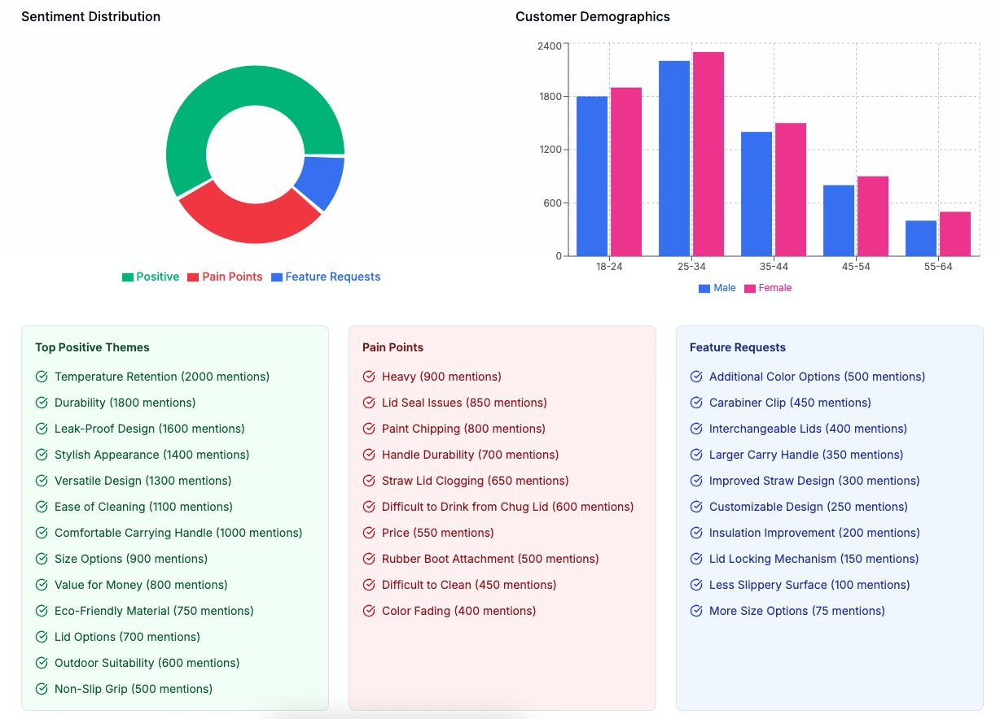
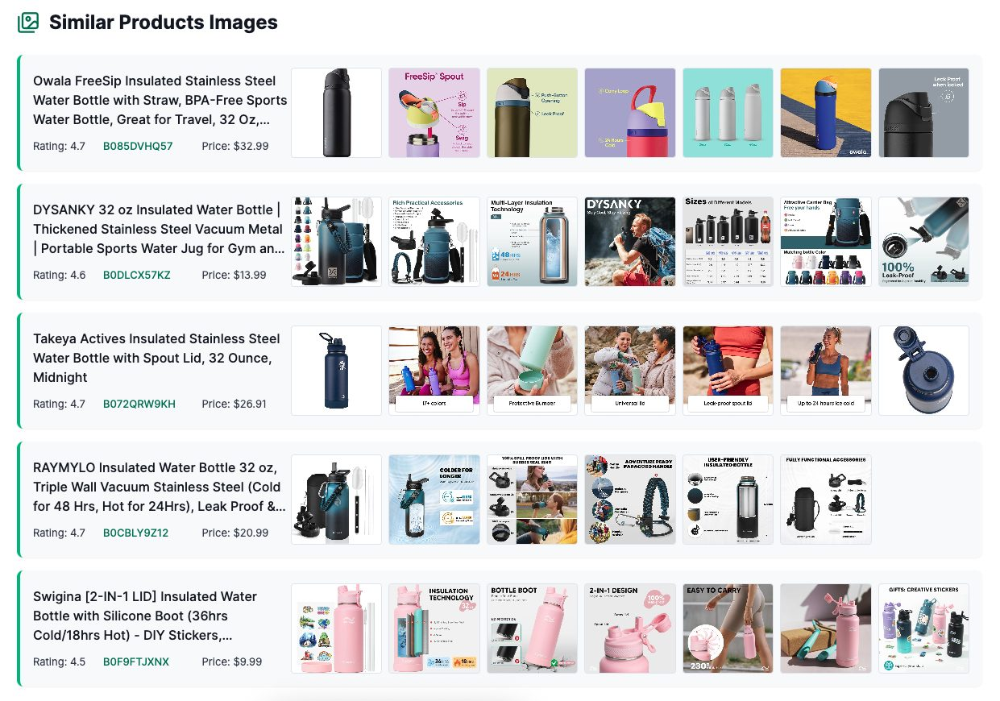
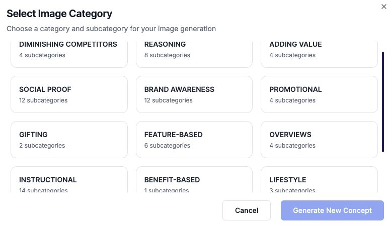
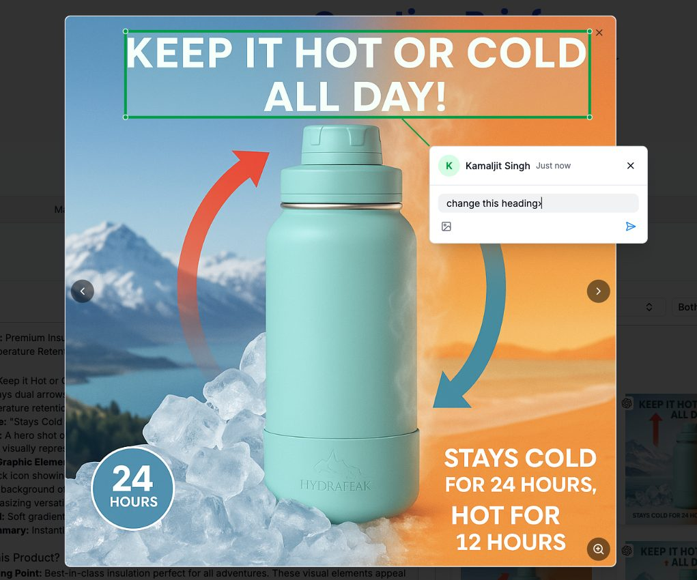
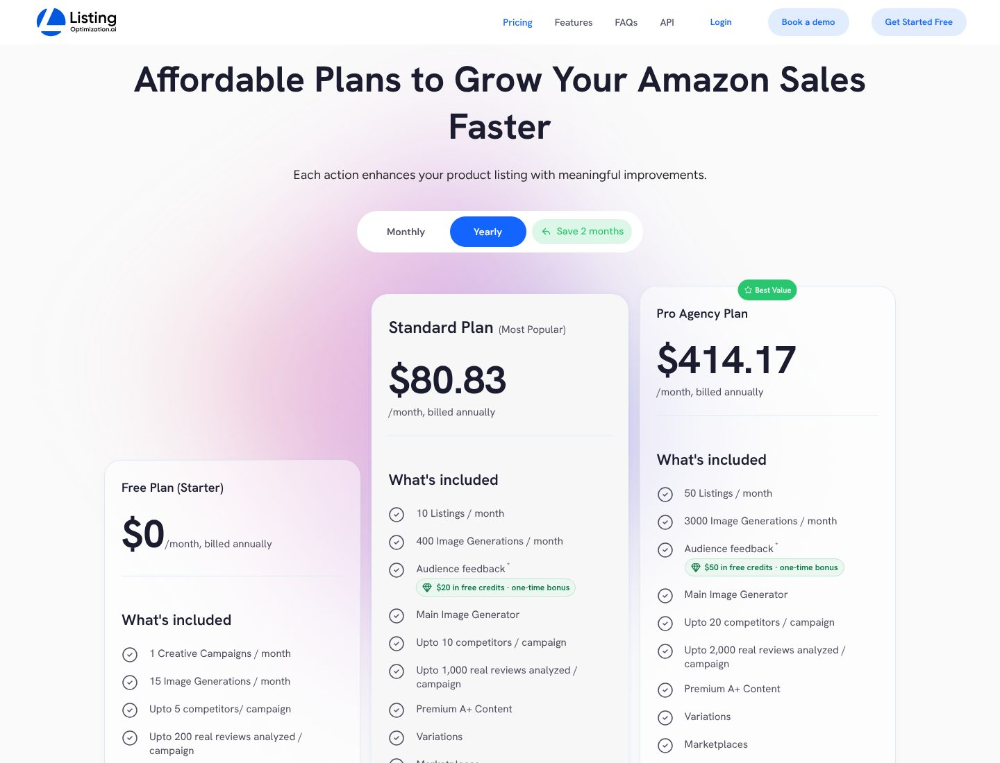
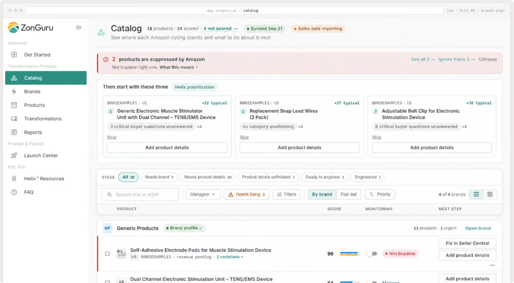
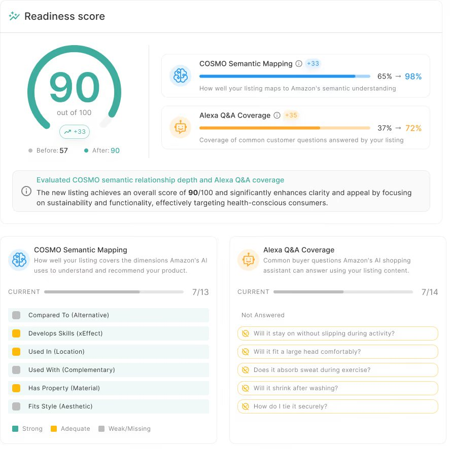
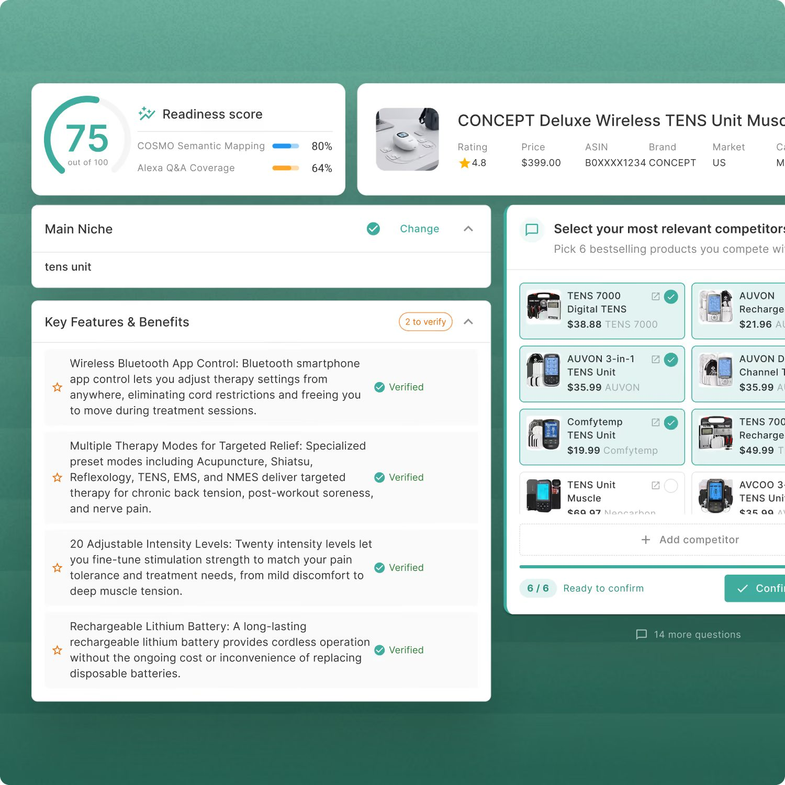
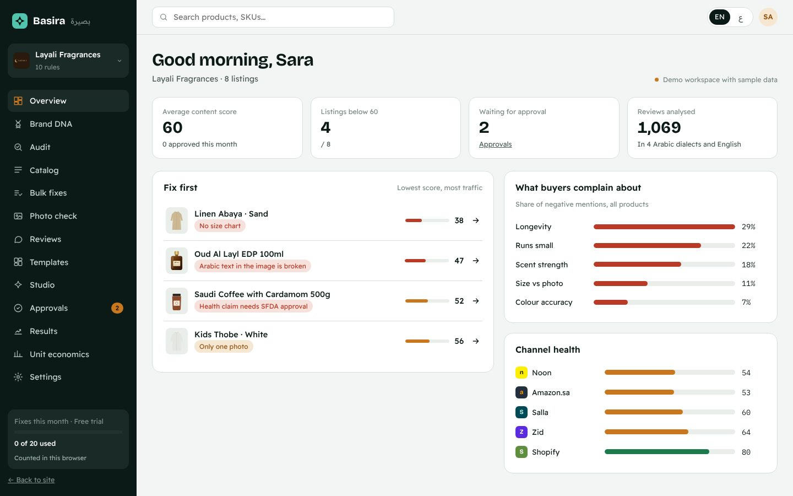
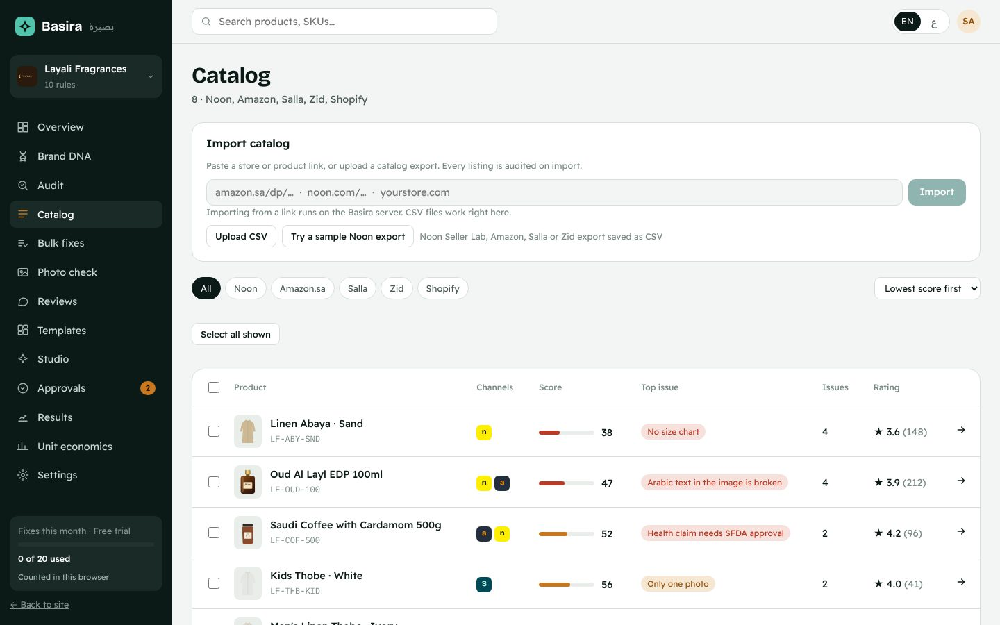

# Конкуренты: кто ближе всего к Basira и чем их кабинет отличается от нашего

Разбор от 2026-11-05. Вторая версия, после захода на сайты.

**Как собирались данные:**
- Прочитаны официальные страницы ZonGuru Helix, Listing Optimization AI, Streamoid Catalogix, Ecomtent и SellerDen AI (список в конце).
- Экраны кабинетов взяты из того, что вендоры публикуют сами. Для Helix это скриншоты продукта на сайте zonguru.com. Для Listing Optimization AI — пошаговый гайд основателя в блоге AMZ One Step.
- В сами кабинеты я не входил: для этого нужна регистрация.
- Цены сняты с официальных страниц 2026-11-05.

**Что поменялось после захода на сайты.** Первая версия опиралась на сторонние обзоры, и они оказались неполными. У Listing Optimization AI есть публикация в Seller Central, A/B-тесты, симуляция выдачи, сравнение галереи с конкурентами и оценка готовности к Alexa. Поэтому вывод «ближе всего» изменился (раздел 2).

## 1. С чем сравниваем: «дух» Basira

Basira — это замкнутый цикл для агентства, а не генератор карточек:

1. **Найти пробелы:** оценка контента, «исправить сначала».
2. **Голос покупателя:** отзывы на диалектах → темы жалоб → что ответить в карточке.
3. **Исправить в стиле бренда:** тексты и слайды по Brand DNA, которая учится на правках.
4. **Согласовать:** очередь, причины отклонения учат бренд.
5. **Выпустить:** ZIP для площадок, публикация на Amazon.
6. **Доказать эффект:** до/после с контрольной группой, отчёт под логотипом агентства.
7. **Всё это для агентства:** клиенты, массовая обработка, арабский язык, Noon / Amazon.sa / Salla / Zid.

## 2. Вывод

**Ближе всего по духу — Listing Optimization AI (AMZ One Step).** Обещание то же, что у нас:
- прочитать отзывы, свои и конкурентов;
- найти, чего не хватает карточке;
- сделать картинки, A+ и тексты в стиле бренда;
- выложить в Seller Central и проверить A/B-тестом.

Сделан агентством, которое работало с 4 000+ брендами, и прямо продаётся агентствам. Чего у него нет: арабского и нашего региона, бренда, который учится на правках, согласования с клиентом, доказательства эффекта продажами и наблюдения после публикации.

**Ближе всего по устройству кабинета и второй половине цикла — Helix (ZonGuru).** Главный экран — каталог, где у каждой карточки есть «следующий шаг». Правила бренда работают как жёсткие ограничения, человек утверждает «до/после». Публикация подтверждается квитанцией, а каждую ночь Helix проверяет, не уехала ли карточка. Работает только с текстом, только Amazon US и UK.

Остальные дальше:
- **Catalogix** — операционка каталога для фэшн, с шаблонами Noon, Namshi, Ounass и Amazon.ae, без голоса покупателя.
- **Ecomtent** — генерация и оптимизация под ИИ-поиск.
- **Российские сервисы** — наборы генераторов для селлера, а не агентский цикл.

| | Пробелы | Отзывы | Исправления | Бренд | Согласование | Выпуск | Эффект | Агентства | Арабский / MENA |
| --- | --- | --- | --- | --- | --- | --- | --- | --- | --- |
| **Basira** | ✅ оценка, «исправить сначала» | ✅ свои, 4 диалекта | ✅ тексты + слайды, фото на модели | ✅ учится на правках | ✅ очередь с причинами | ◐ ZIP; Amazon API не проверен вживую | ✅ продажи с контрольной группой, PDF | ◐ клиенты, нет авторизации | ✅ |
| **Listing Optimization AI** | ✅ Market Intelligence, сравнение галереи, готовность к Alexa | ✅ свои + конкурентов, до 2 000 на кампанию | ✅ картинки, A+, тексты, 100+ шаблонов | ◐ бренд-кит (цвета, шрифты, логотип) | ◐ комментарии к области картинки, команда | ✅ Seller Central в один клик | ◐ A/B-тесты, «Performance insights» | ✅ отдельный бренд-кит на клиента, до 20 мест, white label | ❌ 8 рынков, без MENA |
| **Helix (ZonGuru)** | ✅ оценка готовности, приоритет по выручке | ◐ вопросы ИИ-ассистента, без разбора отзывов | ◐ только текст | ✅ правила на 3 уровнях, жёсткие | ✅ «до/после» | ✅ публикация + квитанция | ◐ ночной мониторинг и тренд оценки, без продаж | ✅ аккаунт на клиента, цена за клиента | ❌ US, UK |
| **Catalogix (Streamoid)** | ✅ пробелы в данных, отказы | ❌ | ✅ атрибуты, тексты, переводы, фото | ✅ гайдлайны | ✅ этапы, роли, журнал | ✅ API, почта, FTP, шаблоны | ◐ приёмка и подавление | ◐ изоляция пространств | ◐ шаблоны Noon UAE/KSA/EG, AR+EN |
| **Ecomtent** | ✅ бесплатный аудит | ? | ✅ картинки, A+, тексты | ✅ гайдлайны | ? | ? | ◐ аналитика ИИ-поиска | ✅ тариф Agency | ❌ |
| **SellerDen AI (Россия)** | ◐ аудит фото и карточки | ✅ автоответы | ✅ инфографика, фотосессии, видео, SEO | ❌ | ❌ | ❌ | ◐ A/B главного фото | ❌ | ❌ |

✅ есть · ◐ частично · ❌ нет · ? не нашёл

## 3. Listing Optimization AI подробно

**Что даёт один ASIN.** За ~13 минут сервис выдаёт:
- отчёт Market Intelligence: кто выигрывает выдачу и почему (цена, рейтинг, число отзывов, BSR), что хвалят, ругают и спрашивают в своих и чужих отзывах;
- «аватар покупателя»: боли, желания, возражения, триггеры покупки;
- обоснование каждой идеи: какую боль она закрывает и какую дыру у конкурента использует;
- 3 концепции главного фото, 4–6 инфографик, 2 lifestyle-сцены, готовые модули A+ и тексты карточки ([FAQ](https://listingoptimization.ai/)).

**Как устроен кабинет (скриншоты из гайда основателя, [AMZ One Step](https://amzonestep.com/blog/amazon-listing-optimization-ai-guide/)):**

1. **Market Intelligence Generator:** поиск по ASIN или по ключевому слову (для товара, которого ещё нет) и выбор рынка.
2. **Отчёт по отзывам:** распределение тональности (позитив, боли, пожелания), демография покупателей, три колонки «что любят», «на что жалуются», «чего хотят» с числом упоминаний.
   
3. **Галереи конкурентов:** весь набор фото каждого конкурента в ряд, с рейтингом, ASIN и ценой.
   
4. **Кнопки над отчётом:** «Generate Listing Copywriting», «Create Brief», «Download», «Share», «History».
5. **Бриф → генерация.** Выбор модели (OpenAI или Gemini; по словам основателя, ChatGPT иногда меняет детали товара). Шаблоны разложены по задачам: Social proof — 12 подкатегорий, Instructional — 14, Brand awareness — 12, Gifting, Lifestyle и другие.
   
6. **Правки:** выделить область на картинке и оставить комментарий дизайнеру; перегенерация с готовыми подсказками; «AI edit copilot» сам предлагает улучшения.
   
7. **Перед публикацией:**
   - симуляция выдачи: главное фото в размере миниатюры среди реальных конкурентов;
   - сравнение галерей слот в слот: главное против главного, инфографика против инфографики;
   - A/B-тест;
   - оценка готовности к Alexa for Shopping: на какие вопросы категории отвечает карточка и каких фото не хватает против конкурентов.
8. **Публикация:** в Seller Central через официальное подключение Amazon. Без подключения — скачивание файлов.

**Ещё:** клонирование удачного изображения конкурента (структура, не копия), варианты по цвету и размеру, перевод картинок на 8 рынков (US, UK, India, Germany, France, Italy, Spain, Japan; арабского нет), API, «Audience feedback».

**Для агентств** вендор описывает такой сценарий:
- каждого нового клиента прогоняют через Market Intelligence в первый день — получается креативный аудит к первому звонку;
- бренд-киты клиентов хранятся раздельно;
- команда работает в одном месте;
- в Pro Agency добавляются white label и персональный менеджер.

**Тарифы (официально, 2026-11-05):**

| | Free | Standard | Pro Agency |
| --- | --- | --- | --- |
| Цена | $0 | $97/мес ($80,83 при оплате за год) | $497/мес ($414,17 за год) |
| Листингов в месяц | 1 | 10 | 50 |
| Генераций изображений | 15 | 400 | 3 000 |
| Конкурентов на кампанию | 5 | 10 | 20 |
| Отзывов на кампанию | 200 | 1 000 | 2 000 |
| A+, вариации, A/B, SERP, Alexa | — | ✅ | ✅ |
| Пользователей | — | до 5 | до 20 |
| White label, менеджер | — | — | ✅ |

**Цифры, которым не верить без проверки:**
- на главной написано «1 000+ брендов и 100+ агентств» и «+27 % конверсии»;
- на странице цен — «2 400+ брендов и агентств», «65 000+ карточек» и «+40 % конверсии»;
- в Trustpilot есть жалоба на списания после отмены подписки ([Trustpilot](https://uk.trustpilot.com/review/amzonestep.com)).

## 4. Helix (ZonGuru) подробно

**Цикл:** Score → Alert → Engineer → Publish → Verify. Карточка проверяется на четырёх слоях: семантика (COSMO), вопросы покупателя (Alexa for Shopping), соответствие аудитории, полнота данных каталога ([Helix](https://www.zonguru.com/helix)).

**Главный экран — Catalog** (скриншот с [zonguru.com](https://www.zonguru.com/features)):

- **Шапка:** «18 products · 14 scored · 4 not scored», когда была синхронизация, идёт ли загрузка продаж. Каталог оценивается в порядке выручки до лимита тарифа, остальное помечено «не оценено».
- **Красная плашка:** «2 products are suppressed by Amazon» с кнопками «показать», «игнорировать», «свернуть».
- **«Then start with these three»:** три карточки, у каждой ожидаемый прирост оценки («+22 typical»), конкретная причина («3 critical buyer questions unanswered») и одна кнопка действия.
- **Этапы работы как фильтры:** Needs brand 5 · Needs product details 10 · Product details unfinished 1 · Ready to engineer 1 · Engineered 1.
- **Таблица сгруппирована по брендам:** у каждого бренда статус профиля, «13 products · 1 urgent», «Open brand». В строке — оценка с полосой, переключатель мониторинга, статус («Not buyable») и кнопка следующего шага («Fix in Seller Central», «Add product details», «Manage»). Массовые действия по выделению.
- **Меню построено по процессу:** Get Started → Transformation Process (Catalog, Brands, Products, Transformations, Reports) → Finalize & Publish (Launch Center) → Info Hub. Текущий тариф виден в шапке.

**Оценка карточки:**

- общий балл и «до/после»: 57 → 90;
- два слоя с процентами: COSMO 65 % → 98 %, вопросы Alexa 37 % → 72 %;
- объяснение словами;
- чек-лист семантических связей: «используется с», «где используется», «материал» — по каждой сильно / средне / слабо;
- **список вопросов покупателя, на которые карточка не отвечает:** «Will it fit a large head comfortably?», «Does it absorb sweat?».

**Подготовка карточки:**

- ниша;
- ключевые свойства товара, каждое человек отмечает «Verified» (факты подтверждаются до генерации);
- выбор 6 конкурентов из бестселлеров.

Бренд заводится через «Find My Brand»: Helix сам ищет бренд в сети и ведёт по анкете.

**Правила бренда** ([features](https://www.zonguru.com/features)):
- черновик правил Helix составляет сам по анкете: запрещённые слова, обязательные фразы, длина, тон, оформление вариаций; человек их правит;
- у правил три уровня: бренд, товар и разовый прогон, и исключение для одного прогона не становится постоянным;
- нарушение правила или политики Amazon блокирует публикацию, а не проходит тихо.

**Мониторинг:**
- управляемые карточки проверяются каждую ночь: изменение контента, падение оценки, подавление, потеря Buy Box, расхождение с утверждённым текстом, удаление из каталога;
- оповещение приходит один раз на проблему, не повторяется, пока она открыта, и закрывается уведомлением о восстановлении.

**Публикация:**
- ничего не уходит без утверждения «до/после»;
- квитанция подтверждает, что текст на Amazon;
- повторная отправка после отказа бесплатна;
- один прогон покрывает всё семейство вариаций.

**Агентствам** ([agencies](https://www.zonguru.com/agencies)):
- у каждого клиента свой аккаунт и своё подключение;
- отдельного агентского тарифа нет: цена за аккаунт клиента и снижается с их числом;
- в отчёте по каждой переработке — оценка «до/после» и квитанция публикации;
- первую карточку клиента можно прогнать за один кредит до подключения его Seller Central.

**MCP:** входит во все тарифы, Helix можно водить из Claude или ChatGPT ([MCP](https://www.zonguru.com/mcp-library)).

**Тарифы (официально, 2026-11-05)** ([pricing](https://www.zonguru.com/pricing)):

| | Starter | Growth | Pro | Enterprise |
| --- | --- | --- | --- | --- |
| В месяц | $149 | $299 | $699 | по запросу |
| За год | $1 490 | $2 990 | $6 990 | |
| Карточек под наблюдением | 15 | 50 | 100 | своё |
| Переработок в месяц | 5 | 10 | 25 | своё |

Отдельный кредит стоит $49, пакет из трёх — $99. Купленные кредиты не сгорают. Оценка и мониторинг доступны только на тарифе. Нужен профессиональный аккаунт продавца Amazon. После отмены данные хранятся 60 дней. Вендор заявляет «5 000+ брендов и агентств, $200M+ выручки клиентов».

## 5. Кабинеты рядом с нашим

**Наш Overview и каталог** (демо-данные, тот же размер экрана):

| | Helix | Listing Optimization AI | Basira |
| --- | --- | --- | --- |
| С чего начинается работа | Каталог: что сломалось, с чего начать, какой следующий шаг | Отчёт Market Intelligence по одному ASIN | Overview: средняя оценка, «ниже 60», «ждут согласования», «отзывов разобрано», «исправить сначала», темы жалоб, здоровье каналов |
| Ответ на вопрос «что делать сейчас» | Кнопка следующего шага в каждой строке, этапы работы, тройка с ожидаемым приростом | Кнопки «бриф», «тексты» над отчётом | «Исправить сначала» с главной проблемой, без ожидаемого эффекта и без кнопки действия; в каталоге «главная проблема» и число проблем |
| Срочное | Плашка «подавлено Amazon», оповещения | Нет | Нет |
| Свежесть данных | «Synced Sep 21», «Sales data importing» | История отчётов | Нет |
| Клиенты агентства | Группировка по брендам в одной таблице | Бренд-кит на клиента | Переключатель клиента; общего вида по всем клиентам нет |
| Голос покупателя | Вопросы ИИ-ассистента, на которые нет ответа | Тональность, демография, «любят / жалуются / хотят» с числом упоминаний, свои и чужие отзывы | Темы жалоб по диалектам, цитаты, ответы на отзывы; только свои отзывы |
| Конкуренты | Выбрать 6 | Найти автоматически, сравнить галереи, клонировать удачное | Нет |
| Проверка фактов | «Verified» у каждого свойства | Нет | Нет |
| Оценка | Готовность к ИИ: «до/после», слои, чек-листы | Готовность к Alexa, сравнение галерей | Оценка контента по 5 частям и оценка соответствия Brand DNA |
| Тариф в интерфейсе | В шапке | — | Счётчик исправлений в боковом меню |

**Главная разница.** Наш главный экран показывает, что плохо в целом. Helix показывает, что делать прямо сейчас и что сломалось сегодня. У Listing Optimization AI главный экран — исследование покупателя и конкурентов, и он глубже нашего разбора отзывов в двух местах: чужие отзывы и пожелания покупателей («хотят») отдельно от жалоб.

**Неточность у нас.** Подпись «Исправить сначала» обещает «низкая оценка, много трафика», а список сортируется только по оценке: трафика у нас нет.

## 6. Catalogix и российские сервисы

**Catalogix** (Streamoid, фэшн; [Catalogix](https://streamoid.com/catalogix), [Noon guide](https://streamoid.com/resources/guides/noon-seller-guide)). «Агенты»:
- собирают данные из любых источников, в том числе входят во внутренние системы под учётными данными клиента;
- чистят данные и заполняют атрибуты по фото (цвет, узор, вырез, материал, текст на упаковке);
- пишут тексты под площадку и делают визуал;
- публикуют через API или «ручными» путями: почта, FTP, загрузка шаблона в кабинете;
- исправляют то, за что площадка отклонила товар, и следят за статусом до выхода.

Для Noon Streamoid заявляет шаблоны UAE/KSA/Egypt (макросные Excel .xlsm), генерацию на арабском и английском, проверку фото и исправление отказов. Для энтерпрайза — согласование по этапам с ролями и журналом, изоляция рабочих пространств и данные в своём регионе. Цен на сайте нет. Это главный, кто может прийти на наш рынок со стороны операционки.

**SellerDen AI** ([сайт](https://sellerden.ai/)). Инструменты:
- генератор карточки и ИИ-инфографика по промту и по референсу;
- фотосессия, в том числе «из примерочной ПВЗ» и праздничная;
- перевод инфографики, генератор фона, видео из фото;
- A/B-тест главного фото;
- аудит фото с 4 сценариями пересъёмки;
- SEO-описания, автоответы на отзывы, ассистент по Ozon, подбор товара.

Тарифы 0 / 599 / 3 690 / 11 990 ₽ ([обзор](https://mpagency.ru/blog/luchshie-nejroseti-dlya-sellerov-marketplejsov-2026-reyting/)). Это набор генераторов для селлера; бренда, согласования и агентского слоя нет.

Остальные российские: GuruSeller (SEO-аудит на 100 баллов), EGGHEADS (сводка до 1 000 отзывов WB), OneScreen (аналитика и ИИ-агенты с действиями через API под контролем человека). У площадок есть встроенные инструменты: на WB «Анализ внимания», на Ozon отзывы в платной подписке.

## 6а. Масштаб компаний (оборот)

Обе компании частные и выручку не публикуют. Ниже оценки агрегаторов, а не отчётность.

**ZonGuru (Helix):**
- выручка $2–4,4 млн в год: GetLatka — ~$2,2 млн (оценка на сентябрь 2025), Datanyze — $4,4 млн, ZoomInfo — «до $5 млн»; выброс LeadIQ ($50–100 млн) не похож на правду;
- 18–22 сотрудника;
- основана в 2016, 4 года росла без инвестиций в плюс, в 2022 взяла посевной раунд у StageDotO (оценки суммы расходятся: от $0,5 до 2,4 млн);
- трафик сайта ~19–21 тыс. визитов в месяц в конце 2025: для известного когда-то набора инструментов это мало;
- в 2026 ZonGuru перестала продавать исследовательский набор и оставила только Helix, то есть ставит компанию на этот продукт;
- «5 000+ брендов и $200M+ выручки» на их сайте — это выручка клиентов, а не их собственная.

**AMZ One Step (Listing Optimization AI):**
- выручка агентства ~$5,3 млн в год по ZoomInfo и RocketReach (2025); основатель в интервью говорит о «нескольких миллионах» («multiple seven figures»);
- 150+ человек (по словам основателя), студии в Канаде, США, Великобритании и Китае;
- основано в 2017, Эдмонтон, Канада;
- выручку самого Listing Optimization AI не нашёл нигде.

**Грубая прикидка выручки Listing Optimization AI (моя, не данные).** Страница цен заявляет «2 400+ брендов и агентств» и «10 000+ селлеров пробовали».
- Если бы все 2 400 платили минимальный тариф $97, было бы ~$2,8 млн в год. Это потолок, а не оценка.
- Реалистично платят сотни, а не тысячи, то есть продукт, скорее всего, приносит меньше $1 млн в год.

**Что это значит для нас.** Оба ближайших конкурента — маленькие компании с выручкой в единицы миллионов долларов и командами от 20 человек (продукт) до 150 (агентство с продуктом). Крупного игрока, который занял бы нишу «контент для агентств», нет ни в США, ни у нас в регионе.

Источники: [GetLatka: ZonGuru](https://getlatka.com/companies/zonguru.com), [Datanyze](https://www.datanyze.com/companies/zonguru/400583432), [ZoomInfo: ZonGuru](https://www.zoominfo.com/c/zonguru-pte-ltd/400583432), [PitchBook](https://pitchbook.com/profiles/company/467592-04), [CB Insights](https://www.cbinsights.com/company/zonguru/financials), [LeadIQ](https://leadiq.com/c/zonguru/5e8db16d03157faf177508f2), [Starter Story](https://www.starterstory.com/amazon-based-toolset), [Teaser Club: StageDotO](https://teaserclub.com/investors/stagedoto), [трафик ZonGuru](https://aitools-main-fajlzj.laravel.cloud/tools/zonguru/statistics), [ZoomInfo: AMZ One Step](https://www.zoominfo.com/c/amz-one-step/461464720), [RocketReach](https://rocketreach.co/amz-one-step-profile_b47e7ec2fc50d13c), [Forbes Councils: Kamaljit Singh](https://councils.forbes.com/profile/Kamaljit-Singh-CEO-Founder-AMZ-One-Step/f461ae83-b73a-435a-9f50-34c4c7a4f658), [интервью Kamaljit Singh](https://www.inspiredinsider.com/kamaljit-singh-interview/2/), [тарифы Listing Optimization AI](https://listingoptimization.ai/pricing).

## 7. Что взять, по приоритету

1. **Главный экран «что делать сейчас»** (Helix):
   - «следующий шаг» кнопкой в каждой строке каталога;
   - этапы работы как фильтры: нет бренда → нет фото → готово к исправлению → на согласовании → одобрено → выгружено → опубликовано;
   - тройка «начни с этих» с ожидаемым приростом оценки и одной причиной;
   - срочные плашки сверху;
   - отметка, когда данные обновлялись;
   - для агентства — общий вид по всем клиентам с числом срочных у каждого.
2. **Наблюдение и квитанция после публикации** (Helix). Каждую ночь перечитывать опубликованные карточки: дрейф, подавление, исчезнувшие фото, падение оценки. Оповещение — одно на проблему, с уведомлением о восстановлении. После PATCH в SP-API — квитанция «встало».
3. **Чего хотят покупатели, а не только на что жалуются** (Listing Optimization AI), и **на какие вопросы карточка не отвечает** (Helix). Добавить в разбор отзывов колонку «хотят» с числом упоминаний, а в карточку товара — список вопросов без ответа. Это прямой вход в бриф на слайды.
4. **Конкуренты** (оба). Выбрать до 6 конкурентов, разобрать их отзывы, поставить галереи слот в слот с нашей, симулировать выдачу (наше главное фото миниатюрой среди их). Особенно сильно для Noon и Amazon.sa, где этого никто не делает на арабском.
5. **Проверка фактов до генерации** (Helix). Ключевые свойства товара отмечаются «проверено» человеком; генерация опирается только на проверенное. Хорошо ложится на Product Memory.
6. **Бриф с обоснованием** (Listing Optimization AI). У каждого слайда — какую боль или вопрос он закрывает. Клиент утверждает бриф до генерации.
7. **Комментарий к области слайда** (Listing Optimization AI) вместо одних кнопок-причин. Отмеченную область тоже учить в Brand DNA.
8. **Правила как жёсткие ограничения** (Helix). Нарушение активного правила Brand DNA блокирует выгрузку и публикацию, а не только снижает оценку. Плюс три уровня правил: бренд, товар, разовое исключение.
9. **Шаблоны по задачам** (Listing Optimization AI). Сгруппировать наши 17 шаблонов так же: доверие, инструкция, подарок, сравнение — и наращивать.
10. **MCP-сервер Basira** (Helix).
11. **Цены** (оба):
    - первая карточка бесплатно как вход;
    - цена за клиента со скидкой за объём;
    - купленные кредиты не сгорают;
    - неудачный прогон возвращает кредит;
    - лимит мест в команде как рычаг тарифа.

## 8. Где мы впереди и что защищать

- **Арабский по-настоящему:** диалекты в отзывах, Noon, Salla, Zid. Про картинки см. [`focus-2026-11.md`](focus-2026-11.md), раздел 5: сильные генеративные модели в 2026 пишут короткий арабский заметно лучше, и преимуществом может быть проверка каждой буквы, а не наш способ набора. У Listing Optimization AI 8 рынков без MENA, у Helix — US и UK.
- **Бренд, который учится на правках.** У Helix правила составляются по анкете и правятся вручную, у Listing Optimization AI — только бренд-кит.
- **Доказательство эффекта продажами** с контрольной группой и отчёт клиенту под логотипом агентства. У Helix — оценка «до/после», у Listing Optimization AI — A/B-тесты и заявленные проценты.
- **Согласование с клиентом как часть цикла**, причём отказы учат бренд.

## 9. Где мы слабее

- Нет авторизации, мест в команде и отдельных аккаунтов клиентов. У обоих конкурентов это база.
- Публикация на Amazon, черновики Claude и оплата не проверены вживую.
- Нет конкурентного анализа, симуляции выдачи и A/B.
- Нет наблюдения и квитанции после публикации.
- 17 шаблонов против 100+. Нет генеративных lifestyle-сцен: провайдер фото не выбран.
- Главный экран описывает, а не ведёт к действию.

## Источники

- **Listing Optimization AI:** [главная и FAQ](https://listingoptimization.ai/), [тарифы](https://listingoptimization.ai/pricing), [пошаговый гайд со скриншотами](https://amzonestep.com/blog/amazon-listing-optimization-ai-guide/), [Trustpilot AMZ One Step](https://uk.trustpilot.com/review/amzonestep.com), [обзор SellerStacked](https://www.sellerstacked.co/reviews/listing-optimization-ai)
- **Helix (ZonGuru):** [Helix](https://www.zonguru.com/helix), [функции](https://www.zonguru.com/features), [для агентств](https://www.zonguru.com/agencies), [тарифы](https://www.zonguru.com/pricing), [AI Readiness Score](https://www.zonguru.com/ai-readiness-score), [MCP](https://www.zonguru.com/mcp-library), [listing engineering](https://www.zonguru.com/blog/what-is-listing-engineering), [ASINsider](https://asinsider.com/blog/zonguru-pricing)
- **Streamoid Catalogix:** [сайт](https://streamoid.com/), [Catalogix](https://streamoid.com/catalogix), [Noon guide](https://streamoid.com/resources/guides/noon-seller-guide), [Ounass guide](https://streamoid.com/resources/guides/ounass-seller-guide), [отказы площадок](https://streamoid.com/resources/guides/fix-marketplace-listing-rejections)
- **Ecomtent:** [главная](https://www.ecomtent.ai/), [Amazon](https://www.ecomtent.ai/amazon-listing-software)
- **Россия:** [SellerDen AI](https://sellerden.ai/), [рейтинг mpagency](https://mpagency.ru/blog/luchshie-nejroseti-dlya-sellerov-marketplejsov-2026-reyting/), [МойСклад](https://www.moysklad.ru/poleznoe/marketplejsy/neyroseti-dlya-kartochek-tovarov-dlya-marketpleysov/), [vc.ru: отзывы](https://vc.ru/marketplace/2320586-top-5-ii-instrumentov-dlya-analiza-otzyvov-na-marketpleysakh), [OneScreen](https://onescreen.tech/), [GuruSeller](https://guruseller.ru/seo-audit-ozon-wb/)
- **Прочие:** [Salsify IQ](https://www.salsify.com/press-release-salsify-unveils-salsifyiq-first-pxm-intelligence-layer-for-agentic-commerce), [Yogi](https://www.meetyogi.com/product), [Intelligence Node](https://www.intelligencenode.com/solutions/digital-shelf-analytics/), [DataHawk AI Copywriter](https://docs.datahawk.co/help-center/modules/ai-copywriter/optimize), [Amazon SEO Ranking](https://amazonseoranking.com/help)

Скриншоты конкурентов в `img/` взяты с публичных страниц вендоров (zonguru.com, listingoptimization.ai, блог amzonestep.com) для внутреннего разбора.
